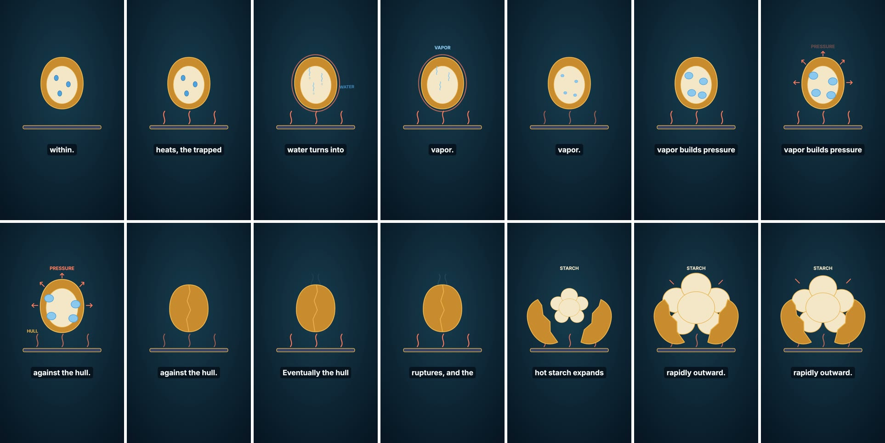
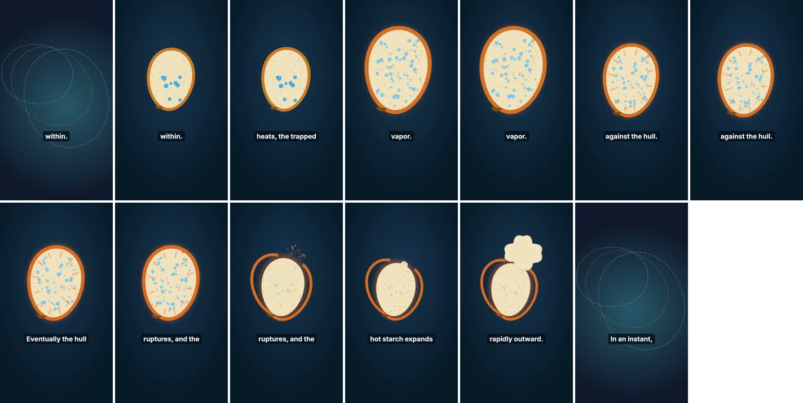

# Popcorn pilot baseline (M2.5 slice 1)

The comparison baseline for the `b3`–`b5` pilot in [the M2.5 plan](../m2.5-animation-quality-plan.md). It is the v1 Fully animated cut produced in the Claude trial.

## Source revision

| Item | Value |
| --- | --- |
| Database | `vcp_claude_trial` (checkout `video-content-pipeline-animation`) |
| Project | `d6c0cc5c-ce97-4fa3-810e-5d59423e09a0` |
| Render | `3b542d65-2662-418b-be1f-61380769f490`, template 1.7.0, 1080×1920, 30 fps, 39.1 s, 1173 frames |
| Storyboard → narration → script | `a2a76d71…` → `afc824eb…` (38.809 s) → `771f5788…` v3 |

The render resolves to its storyboard, the storyboard to its narration, and the narration to its approved script by stored IDs. The portable timing fixture is [`fixtures/animation/popcorn-pilot.json`](../../fixtures/animation/popcorn-pilot.json). It holds all 116 words with global indices, beat timings, claims and cue bindings. It has no audio.

## Pilot bounds

Beat starts round to frames with the renderer's visual-timeline rule: `b3` 12.804 s → 384, `b4` 15.916 s → 477, `b5` 19.137 s → 574, `b6` 23.866 s → 716. The pilot covers frames **[384, 716)**, which is 384–715 inclusive and 332 frames. `sequenceSpans` derives the same bounds from the stored scenes, and `packages/core/src/sequence.test.ts` checks them.

The baseline excerpt with the original voice and captions was extracted locally (not committed) with:

```bash
ffmpeg -i <render>.mp4 -vf "select='between(n,384,715)',setpts=N/30/TB" -af "atrim=start=12.8:end=23.866666,asetpts=PTS-STARTPTS" -c:v libx264 -crf 16 -c:a aac baseline-b3-b5.mp4
```

The result has 332 video frames, AAC audio and a length of 11.067 s. It is saved at `.data/m2.5/popcorn-pilot/baseline-b3-b5.mp4` in the worktree that produced it, with the stills next to it.

## Cue table

A cue frame is `round(word edge × 30)`, rounded before subtracting the sequence start.

| Cue | Word (global index) | Edge time | Global frame | Local frame | Beat |
| --- | --- | --- | --- | --- | --- |
| `heats` | “heats,” (40) | 13.489 s | 405 | 21 | b3 |
| `vapor` | “vapor.” (46) | 15.316 s | 459 | 75 | b3 |
| `builds` | “builds” (51) | 17.488 s | 525 | 141 | b4 |
| `pressure` | “pressure” (52) | 17.806 s | 534 | 150 | b4 |
| `ruptures` | “ruptures,” (59) | 20.225 s | 607 | 223 | b5 |
| `expands` | “expands” (64) | 22.061 s | 662 | 278 | b5 |

## Matched stills



Left to right, top row: 384 (b3 open), 405 `heats`, 459 `vapor`, 476 (last b3), 477 (first b4), 525 `builds`, 534 `pressure`. Bottom row: 573 (last b4), 574 (first b5), 606 (just before `ruptures`), 607 `ruptures`, 662 `expands`, 690 (peak expansion), 715 (settled, last pilot frame). Candidate pilots are compared at the same frames.

## Baseline defects

1. **State resets at both joins.** At 476→477, the vapor wisps, the hull ring and the label vanish, and the droplets return to their pre-heating layout. At 573→574, the cutaway (interior, droplets, pressure arrows) is replaced by an opaque, closed kernel with a pre-drawn crack. Each beat has its own clock and redraws the object.
2. **Rupture lags the cue.** At 606 and 607 the picture is identical. The crack has been visible since 574, before “ruptures” is spoken. The shell opens at about 615–625, which is 0.3–0.6 s after the cue.
3. **Expansion has no origin or follow-through.** Starch appears as a symmetric flower between two hull halves at ~625. It holds still until “expands” (662), then scales up uniformly. There are no fragments, no fast-then-slow motion and no settle. By 690 it has stopped moving, and 715 is unchanged.
4. **Pressure is symbolic, not physical.** Four arrows and a “PRESSURE” label appear around an unchanged hull. Nothing bulges, tightens or holds before release.
5. **Static, small framing.** The kernel occupies about a fifth of the frame width in the upper half for the whole pilot. Camera, scale and negative space never change with the explanation. About 60% of the frame is empty background.
6. **Unreadable labels.** “WATER”, “VAPOR”, “HULL” and “STARCH” are set at roughly 20 px in a 1080-wide frame, and “WATER” is clipped at the hull edge.
7. **Material identities drift.** The water reads as blue ovals in b3, as hollow squiggles at the `vapor` cue and as larger blobs again in b4. The heat source under the kernel is identical squiggles throughout, so heating does not visibly increase.

Captions sit at 0.68 of the height and never collide with the kernel, so caption clearance is not a baseline defect.

## Fixture through the full assembly



The trusted fixture's full-profile intermediate was played through `FactShort` with the original narration and captions (`scripts/sequence-factshort.ts`). The output is H.264 1080×1920 at 30 fps with 1173 frames (39.1 s, the baseline length) and AAC audio. Frames left to right: 383 (Backdrop, `b2`), 384 (sequence start), 405 `heats`, 476/477 and 573/574 (beat joins, no reset), 606, 607 `ruptures`, 624, 662 `expands`, 715 (last sequence frame), 716 (Backdrop, `b6`). This shows the toolkit and worker, not the product pilot.
