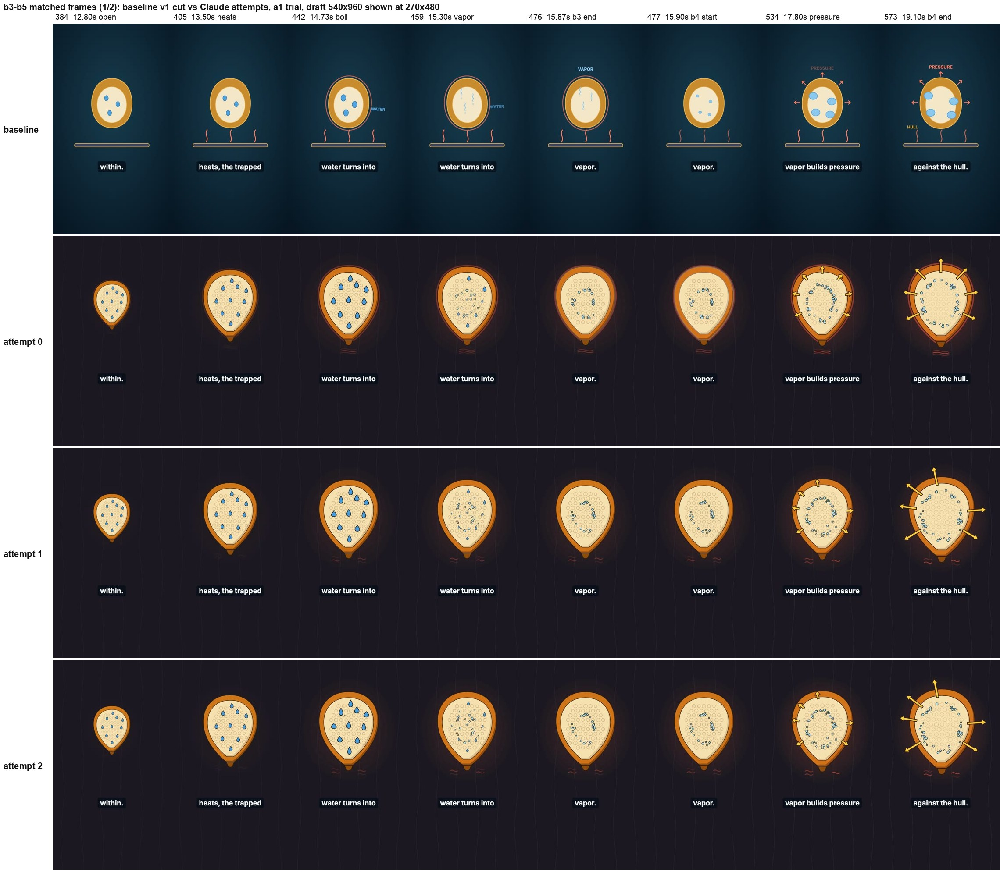
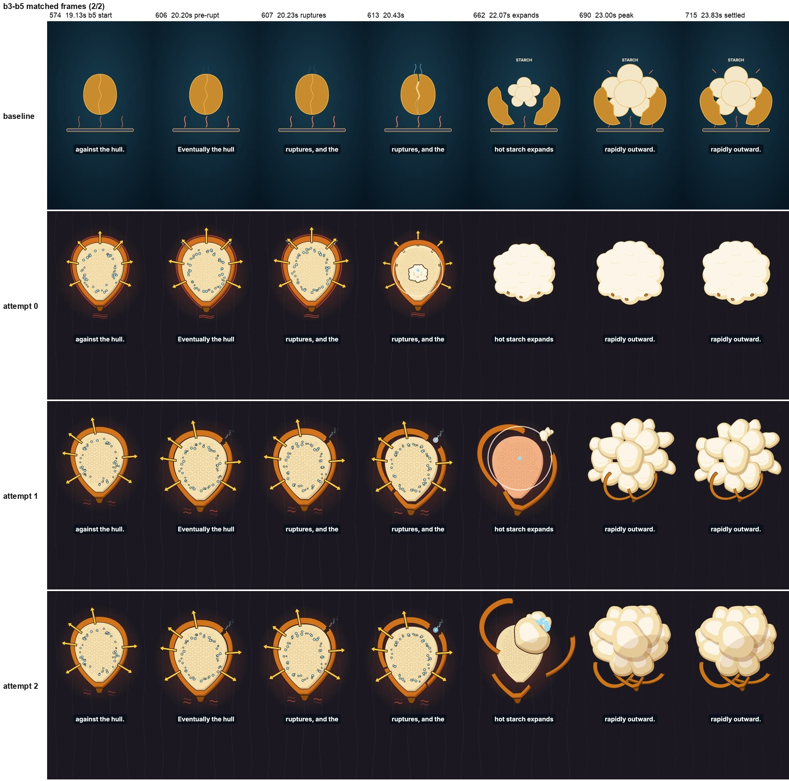
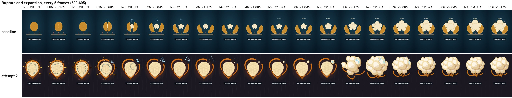

# Popcorn pilot, trial a1 (M2.5 slice 3)

The first real Claude-authored `b3`–`b5` pilot, compared with the [baseline](popcorn-baseline.md). **Disposition: rejected.** All three attempts got `revise` from the critic, so nothing is promoted. The run exposed six defects in the pipeline. All six are fixed, and the critic fix was checked against the saved candidate.

## Setup

| Item | Value |
| --- | --- |
| Model | `claude-opus-5-5`, effort `high` (the effective binding from `vcp_claude_trial`) |
| Inputs | `fixtures/animation/popcorn-pilot.json` timing and script, the saved popcorn narration, seed 1729 |
| Span | frames [384, 716), beats b3–b5, directed sequence `s2-mechanism` (direction covered b1–b6) |
| Budget | initial attempt plus 2 revisions; draft previews at 540×960 with voice and captions |
| Command | `tsx apps/pipeline/scripts/sequence-pilot.ts .data/m2.5/pilot <narration.wav> a1` |
| Prompt version | 1 (the fixes below bump it to 2) |

## Attempts

| Attempt | Author | Preview | Critique | Verdict | Failed criteria |
| --- | --- | --- | --- | --- | --- |
| 0 | 8.0 min, 53.7K out | 64 s | 34 s | revise | mechanism, art, continuity, motion |
| 1 | 17.8 min, 56.0K + 61.5K out (one schema repair) | 86 s | 41 s | revise | art, continuity, motion |
| 2 | 14.8 min, 60.8K + 39.8K out (one schema repair) | 42 s | 33 s | revise | art, continuity |

Wall time for the run that produced attempts 0–2 was 37.6 min. Attempt 0's draft came from the previous run.

**What changed between attempts.** Each critique asked for specific changes, and the next draft made them:

- **Attempt 0.** The hull stayed closed at the "ruptures" cue, and the puff formed inside it. The burst started at the centre, away from the crack. Pressure relaxed before the pop. The hull vanished into three specks.
- **Attempt 1.** The hull now splits at 613. Vapor escapes through the crack, and the puff comes out of the same crack. Pressure holds through the tear. New problems: a salmon-pink "hot starch", a stray white ring, and a pile of separate popcorn pieces.
- **Attempt 2.** The starch stays beige, the ring is gone, and the result is one connected popped kernel. The critic still flagged two things: the puff is outlined separately on top of the old starch at 662, and the hull shards thin out and sit in front of the puff at 696.

### Matched frames

Rows: baseline v1 cut, then attempts 0, 1 and 2, at the frames used in the baseline doc plus the cue and boundary frames.

### Motion strip

The strip shows what neither the critic nor the stills showed. In attempt 2, from about 620 to 660 (1.3 s), the hull is open, the vapor has gone, and the starch does not move until "expands". The critic's 18 frames jumped from 613 to 662.

Playable comparison (not committed): `.data/m2.5/pilot/pilot-a1-compare.mp4` puts the baseline, attempt 0 and attempt 2 side by side with the original audio (1620×960, 332 frames, 11.07 s). The attempt 2 draft alone is `.data/m2.5/pilot/pilot-a1-attempt2-draft.mp4`.

## Against the baseline defects

| Baseline defect | Attempt 2 |
| --- | --- |
| State resets at both joins | Fixed. The kernel, vapor ring and arrows carry across 476/477 and 573/574; the critic passed continuity at both. |
| Rupture lags the cue | The hull splits at 613, 6 frames after "ruptures". The hairline crack arrives about 0.7 s after its own cue at 574. |
| Expansion has no origin or follow-through | The origin is the crack. Follow-through is weak: a stall from 626 to 662, then a jump. |
| Pressure is symbolic | The hull widens, the arrows grow with pressure and the vapor ring circulates. The shake asked for twice is still hard to see. |
| Static, small framing | Better: there is a zoom-in over 384–433. The finished popcorn still sits high in the frame, leaving the lower half empty. |
| Unreadable labels | Fixed: there are no labels; the materials are told apart by colour and shape. |
| Material identities drift | Fixed: the drops become bubbles in place, and the hull, starch and water keep their colours. |

## Defects found and fixed

1. **Output cap.** At high effort the author used 53.7K–61.5K output tokens. With the 32K animation ceiling the first call hit `max_tokens` (about $0.67 lost). `Prompt.maxOutputTokens` now lets the author step ask for 64K; the adapter clamps it to 128K. This is the "measured evidence" the plan asks for before changing the ceiling.
2. **Absent objects.** The first draft gave objects that are off-screen at an edge an all-zero pose, which the manifest rejects. `poseSet` now drops all-zero poses and names the object in any other pose error, and the author prompt says to leave absent objects out.
3. **Billing error looked transient.** An error event inside a stream has no HTTP status, so "credit balance is too low" was raised as a retriable network error. The adapter now maps the error type to a status (`invalid_request_error` → 400, and so on), so it is permanent.
4. **Hidden schema limits.** Structured outputs strip `maxLength`, `minimum` and `pattern`, so the model never saw them. Revisions 1 and 2 each needed a full second author call (about $1.30 and $0.90). The repaired outputs came back with `revisionNotes` at 1120 and 1198 of 1200 characters and `description` at exactly 300. Every limit in the authoring schemas is now also written into a description, which survives. `Prompt.onInvalidOutput` reports the issues of any further miss.
5. **Critic sampling gap.** The critic's frames covered cues and boundaries but left gaps of 34–57 frames, and the 613–662 stall sat in one of them. `critiqueFrames` now splits the widest gap until none is longer than 24 frames (0.8 s), then adds cue follow-through. The budget rises to 28 frames (`MAX_PROMPT_IMAGES` 32). The critic prompt says that a run of unchanged samples is a hold that needs a purpose.
6. **Caption timing false positive.** With the new frames the critic marked delivery `revise` because the caption changed 20 frames after the b5 boundary. Captions follow the spoken words, so its prompt now says not to judge caption timing.

**Correction checked on the saved candidate.** `sequence-pilot.ts … a1 --recritique 2` rendered attempt 2 again with the new sampler (28 frames, the largest gap 24) and critiqued it once ($0.17). This time the critic found the stall (motion at 638), the passive starch core at 626, the late crack at 574, teleporting shards from 662 to 679 and the empty lower half. All of these were missed on the first pass. The full output is in `.data/m2.5/pilot/pilot-a1-recritique-2.json`. Fix 6 came from that output and has not yet been through a model call.

## Unresolved findings (attempt 2, with the re-critique)

- 574: the hairline crack starts about 0.7 s after its cue.
- 613–662: the starch stalls after the rupture; it should erupt through the crack by about 620 and reach full size by about 650.
- 662: the puff is overlaid on the old starch body instead of morphing out of it; a blue vapor clump sticks to the puff.
- 662–696: the hull shards jump positions, thin out and cross in front of the puff.
- 679–715: the finished popcorn sits high (top near y=70 of 960); the lower half is empty.
- b4: the escalating shake is still hard to see.
- 433: the "water" cue has no visual beat.

## Cost and time

| Step | Calls | Input tokens | Output tokens | Cost at $4/$20 per MTok |
| --- | --- | --- | --- | --- |
| Direction (one schema repair) | 2 | 5,091 | 5,194 | $0.12 |
| Author, first run (hit 32K) | 1 | ≈7,200 | 32,000 | ≈$0.67 |
| Author, attempts 0–2 | 5 | 90,008 | 271,836 | $5.80 |
| Critique, attempts 0–2 | 3 | 51,566 | 9,807 | $0.40 |
| Re-critique of attempt 2 | 1 | 23,875 | 3,867 | $0.17 |
| **Total** | 12 | ≈178K | ≈323K | **≈$7.16** |

The author dominates: about 8 minutes and $1.10–1.30 per call. A schema repair doubles that. Image input is cheap: 18 frames came to about 16K input tokens, 28 frames to about 24K. A trial with the fixes, and no schema repairs, should cost about $4–5 for three attempts.

## Next

Run a separately named trial (`a2`) with prompt version 2. The fixes are measured or checked: the output cap, the visible schema limits, the absent-pose rule and the gap-covering critic. That trial is the slice-3 acceptance candidate. Slice 4 (the full cut) waits for an accepted pilot.
